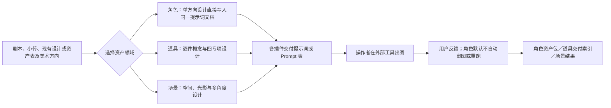
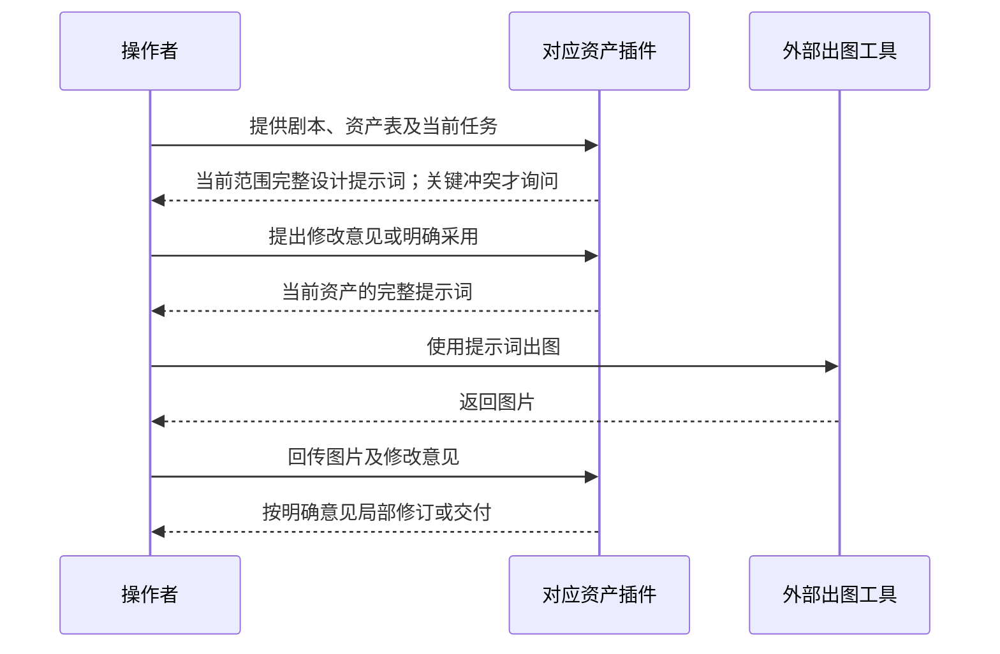
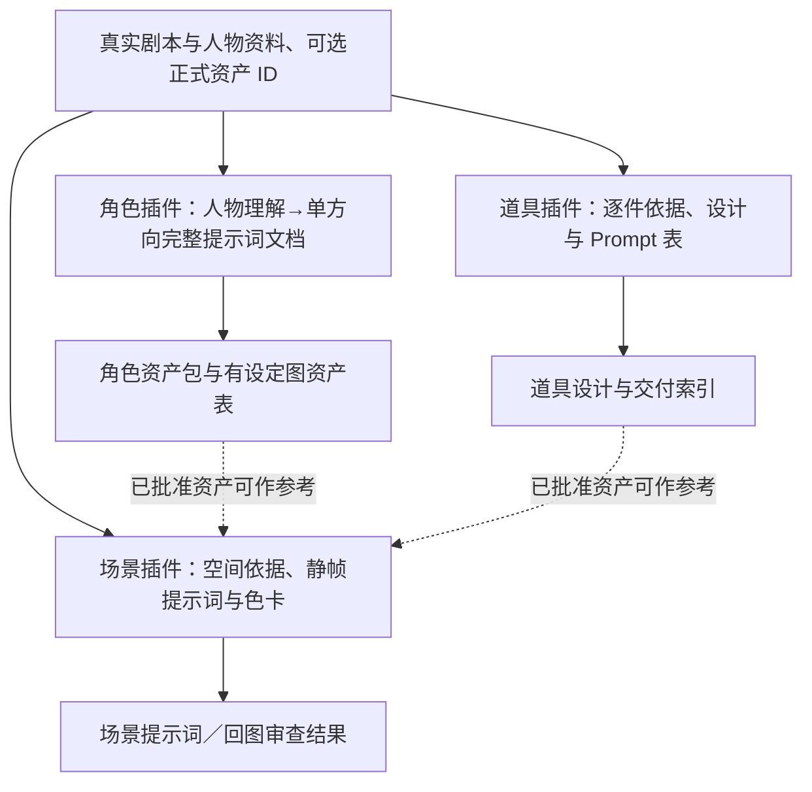

# ZiChan · 影视资产插件

本仓库现已公开，角色、场景、道具能力直接以本仓库的完整插件为准。公开测试镜像 r4 已撤下，后续安装和更新使用本源仓库。

ZiChan 收录三项平行、可独立安装的资产插件。剧本与资产表是共同依据；各插件分别负责人物、道具或场景，不会自动调用另一个插件，也不会自动生成图片。设计、提示词、回图审查和交付以各插件自己的规则为准。

| 插件 | 当前版本 | 维护来源 | 主要交付 |
| --- | --- | --- | --- |
| [角色资产插件](character-assets/README.md) | **v0.2.20** | 项目维护者 | 单一设计方向直接入词，一角色一文档，四类提示词与多状态局部更新 |
| [道具资产插件](prop-assets/README.md) | **v0.2.5** | [18571635839-a11y](https://github.com/18571635839-a11y) | 道具概念与材质、配色、纹样、轮廓专项；逐件设计及完整 Prompt 表 |
| [场景资产插件](scene-assets/README.md) | **v0.10.1** | [runningg0301-prog](https://github.com/runningg0301-prog) | 静态场景设计、光影氛围与色卡、反打／多角度及局部修改提示词 |

插件版本以各目录的 `.codex-plugin/plugin.json` 为准。角色插件另有 `plugin.json` 与项目 CLI；场景插件内置的 Skill 名称保留原拼写 `$sence-prompts`，插件包与技能包版本统一为 v0.10.1，详见[场景插件说明](scene-assets/README.md)。道具插件入口为 `$prop-concept-design`。

道具插件 v0.2.5 新增五份设计参考：形体与体积、特殊材质与光学、分品类常见失败、方向发散、呈现／挂载／状态推进。相关知识按需接入概念、主视觉、审核与扩展节点，保持独立专项的范围及用户确认规则；详见[道具插件更新说明](prop-assets/README.md#参考资料)。

角色 v0.2.20 强化总控自主设计与服饰参考转译：从人物、世界和共享服制出发，先形成整体造型主张，再统筹款式、剪裁、配色、材质和饰品。各专项约20%局部创新是探索许可，不是字数、面积或部件配额；纯审美装饰可以成立，剧情与已批边界保持。新建虚构角色主动判断物种与族裔/外貌背景，在独立提示词中写明当前采用方向，并具体设计肤色、发质和五官。仍保持一个方向、一角色一份文档，按阶段与状态局部更新，默认不自动审图、修补或重跑。已有资产汇总支持原生单元格嵌图及真实行映射校验；旧批准知识快照的读取兼容得到修复。保留22能力、58知识快照，定点更新4份。Python3.12/3.14各323项回归及解包323项通过；实际文字样例验证参考转译、局部材质保真和明确族裔背景，不等于成图审美或普遍提速已经通过。详见[角色说明](character-assets/README.md)、[验证范围](character-assets/VALIDATION.md)及[发布页](https://github.com/kaibaoxiang-studio/ZiChan/releases/tag/character-assets-v0.2.20)。

本版完成了Windows项目文件锁与调度恢复探活的适配，并通过模拟Windows API回归；尚未在Windows真机验收。实际验证覆盖两套Python的代码/状态回归、源码重建与解包，以及多项真实文字设计旅程和五人实测；没有据此宣称图像审美、普遍提速或图像端到端已经通过。角色已有资产汇总可使用原生单元格嵌图导出工具；输入既有复杂XLSX模板时仍需保真编辑工具，不静默重建丢表。实际支持范围与未做的目标应用验证见角色说明。

## 仓库结构

```text
ZiChan/
├── character-assets/   角色资产插件 v0.2.20
├── prop-assets/        道具资产插件 v0.2.5
├── scene-assets/       场景资产插件与技能 v0.10.1
├── .agents/            三插件本地市场清单
├── .gitignore
└── README.md
```

主分支只保留当前插件。旧安装包、历史构建源码与验证研究可从[整理前提交](https://github.com/kaibaoxiang-studio/ZiChan/tree/60e04bf1b45763bacb88ffbdc2bd6f5a96666bed)和 Git 历史取回，不作为当前安装入口。三个插件各自的 README 是能力、输入和交付边界的详细说明。

## 安装与使用

在本机克隆仓库，并从仓库根目录注册统一的本地市场；按需要安装其中一项或多项：

```sh
git clone https://github.com/kaibaoxiang-studio/ZiChan.git
cd ZiChan
codex plugin marketplace add "$PWD"
codex plugin add character-assets@zichan-suite-local
codex plugin add prop-assets@zichan-suite-local
codex plugin add scene-assets@zichan-suite-local
```

若已有个人市场安装，先核对当前插件的市场和版本，再决定是否切换到统一市场。插件目录应完整保留，不能只复制单个 `SKILL.md`；尤其场景插件的知识、脚本和测试位于 `scene-assets/skills/sence-prompts/` 内。

常用入口示例：

```text
$character-assets 根据完整剧本和角色资产表建立人物视觉资产项目。
$prop-concept-design 根据剧本或道具资产表制作逐件设计与完整 Prompt 表。
$sence-prompts 根据场景资产表和剧本设计静态场景提示词。
```

三项插件对来源事实与设计提案分别记录。需要同一角色、道具出现在场景中时，向场景插件提供已经确认的对应资产作为参考；它不会替另外两项插件重新批准设计。图片生成在外部工具进行，回图的实际审查和批准遵循各插件文档。

## 工作流



## 交互时序



## 数据流



工作流表示协作顺序，不代表仓库已经提供跨插件自动调度或统一审批数据库。各插件的实际输入格式和完成条件以其目录内 README、Skill 与接口文件为准。
