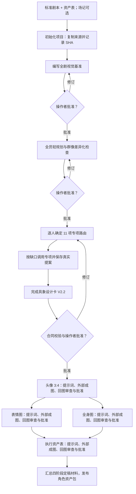
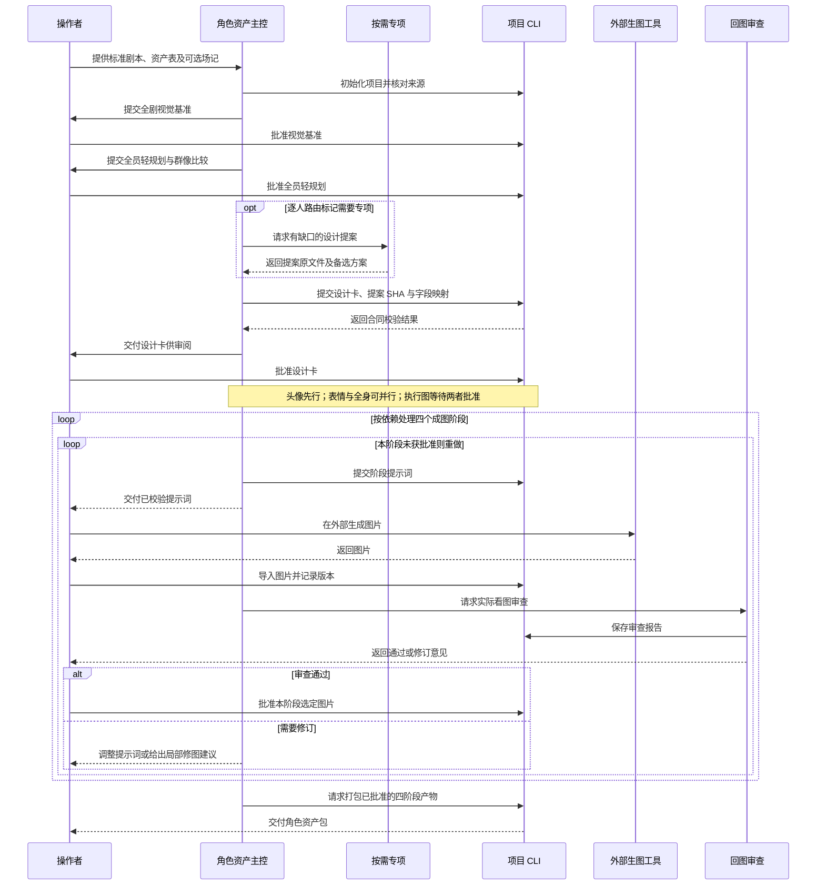
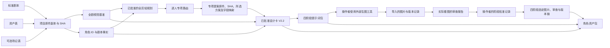

# ZiChan · 资产插件

开宝箱工作室的资产插件仓库。角色、场景、道具及按需建设的特效、音频能力以并列子插件接入；本仓库当前交付 [角色资产插件](character-assets/README.md)、[场景资产插件](scene-assets/README.md)和[道具资产插件](prop-assets/README.md)。其他模块按需另行建设，不提供空壳能力。

角色插件从剧本标准化结果与资产表读取可追溯事实，场记表可选；先确认全剧视觉基准，再用群像差异化总控比较剪影、脸部、体态、发型与服饰色块，按缺口调用发型、形体、五官、皮肤、服饰等 11 个专项。v0.2.2 要求新提交的重点人形设计卡逐项交付可画的五官、发型、体态、皮肤、服饰结构和饰品细节，并展示少量主锚点、三维体块、专项路由与真实提案交接；头像默认 3:4 竖版。然后完成 GPT Image 2.5 提示词、外部成图回流审查和角色资产包。场景插件用同类输入建立场景设计、静帧提示词、回图审查和场景资产包；中式幻想尺度仅在批准的视觉方向中加载。两者均不调用生图 API。聊天附件与本地文件路径均可导入项目工作目录。

道具插件从剧本或道具资产表交付逐件设计与完整 Prompt 表，默认同图正面、侧面、背面加一个局部特写；包含四个可独立使用的材质、配色、纹样符号、轮廓比例专项，不自动生图。

## 角色插件 v0.2.2

- 新增[特征聚焦专项](character-assets/skills/character-feature-focus/SKILL.md)，以少量主锚点和安静区建立辨识度；自然不对称按依据选择，不自动制造伤痕或痣。
- 形体专项补足相对肢体比例、颅胸盆体块、正侧背与剧本动作检查。
- 总控在逐人设计前保存 11 项专项路由。新重点人形卡采用 `CharacterDesignCardV2.2`；已用专项必须交真实提案文件、哈希、被选方案及字段映射。提交、批准和后续读取都会校验交接。旧批准卡继续可读。
- 两份新知识库精炼为 5 份按情景加载的快照；原始 ZIP 留在本地私有源库。完整设计与验证见[增量架构](creator-src/architecture-v0.2.2.md)和[角色插件说明](character-assets/README.md)。

### 流程与交接图

以下三图直接展示角色资产插件 v0.2.2 的工作流、参与者交接和产物去向。

#### 工作流

每个成图阶段的审查若未通过，就修改提示词或图片，重新导入并审查；修改设计卡须重新批准，并使该角色后续产物失效。

#### 交互时序

#### 资产数据流

角色插件编写提示词并管理回流记录；图片由操作者在外部工具生成。最终资产包只收录对应角色变体的已定稿材料。

## 目录

- `character-assets/`：可直接安装的独立插件，包含 Skills、知识快照、Python Harness 和本地项目 CLI。
- `prop-assets/`：道具资产独立插件，包含主技能、四个专项技能和精炼参考，无生图 API 或 Harness 依赖。
- `creator-src/`：角色插件的 Harness Creator 蓝图生成器与自编业务资源；角色插件后续更新先改这里，再审查同步到插件。道具插件直接维护 `prop-assets/`。
- `scene-assets/`：场景资产独立插件，提供条件加载的中式幻想尺度知识与回图审查。
- `scene-creator-src/`：场景插件的蓝图、可维护业务规则及本地项目 CLI 源码。
- `dist/`：可下载的安装 ZIP。
- `research/15-视觉故事待接入知识/`：视频提示词未来能力的候选规则，目前不改变已安装插件。

原始课程 DOCX、ZIP、RAR、剧本与人物图片不随仓库发布。`character-assets/knowledge/index.md` 按使用情景定位精炼 reference，`knowledge/source-register.json` 和 `sources.lock.json` 保留来源版本与改写记录。历史服饰条目仅用于寻找线索，具体准确性需要另行查证。

## 本地优先与团队交接

本机角色插件发布版本为 v0.2.2，包含 18 项能力、27 份知识快照及 V2.2 具象设计卡合同；旧 V1/V2/V2.1 批准记录保持可读。角色资产图的场景背景须有明确批准依据；未批准时使用无场景、无纹理的中性背景。操作者可按 [角色手动验收样例](character-assets/examples/manual-acceptance.md)和[场景手动验收样例](scene-assets/examples/manual-acceptance.md)跑一部作品；图片质量由操作者逐阶段检验。团队从私有 `kaibaoxiang-studio/ZiChan` 下载插件目录或 `dist/` 的安装包。新增素材的采纳与后续路由见[刺猬星球素材拆解](research/刺猬星球素材拆解-2026-10-22.md)。
