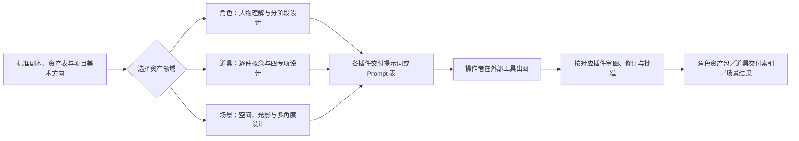
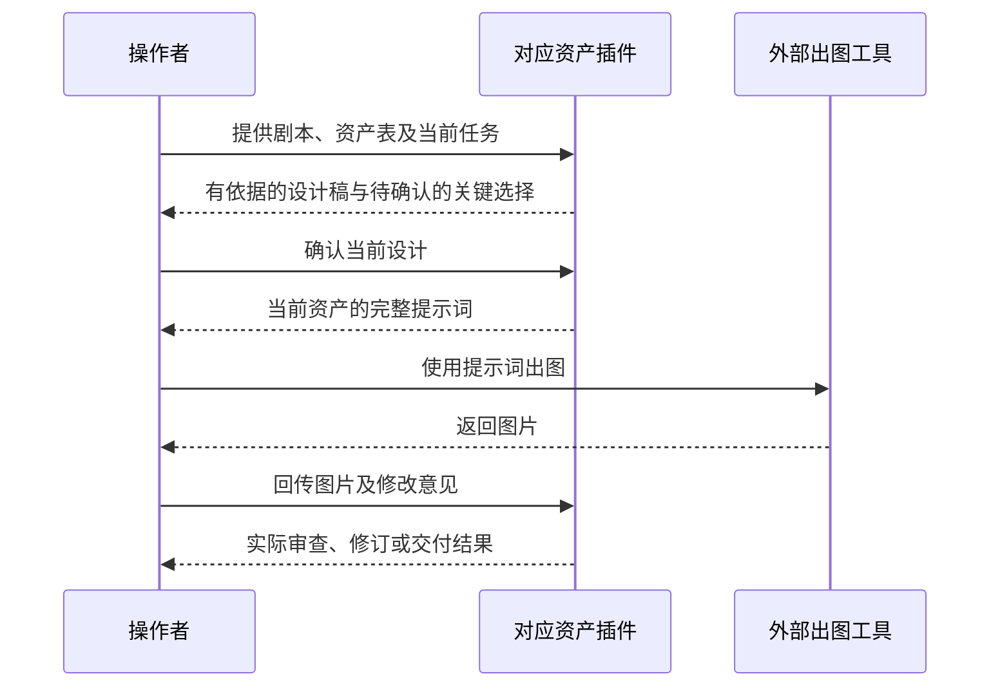
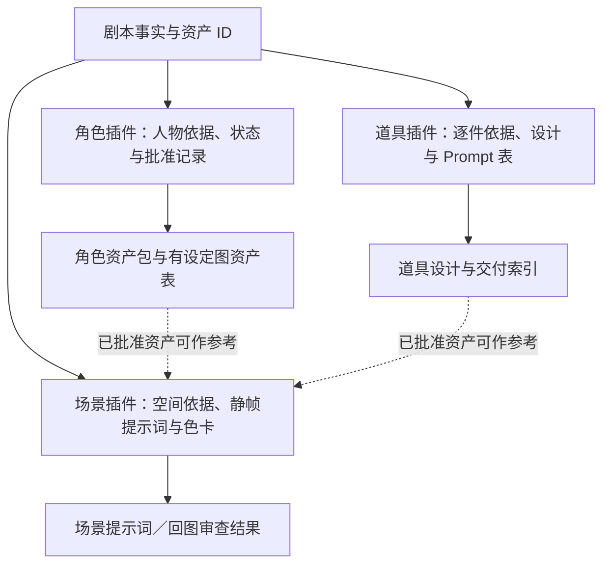

# ZiChan · 影视资产插件

ZiChan 收录三项平行、可独立安装的资产插件。剧本与资产表是共同依据；各插件分别负责人物、道具或场景，不会自动调用另一个插件，也不会自动生成图片。设计、提示词、回图审查和交付以各插件自己的规则为准。

| 插件 | 当前版本 | 维护来源 | 主要交付 |
| --- | --- | --- | --- |
| [角色资产插件](character-assets/README.md) | **v0.2.6.2** | 项目维护者 | 全文人物理解、角色设计、分阶段提示词、回图审查、逐状态资产包与有设定图资产表规则 |
| [道具资产插件](prop-assets/README.md) | **v0.2.0** | [18571635839-a11y](https://github.com/18571635839-a11y) | 道具概念与材质、配色、纹样、轮廓专项；逐件设计及完整 Prompt 表 |
| [场景资产插件](scene-assets/README.md) | **v1.0.0** | [runningg0301-prog](https://github.com/runningg0301-prog) | 静态场景设计、光影氛围与色卡、反打／多角度及局部修改提示词 |

版本以各目录的 `.codex-plugin/plugin.json` 为准。角色插件另有 `plugin.json` 与项目 CLI；场景插件内置的 Skill 名称保留原拼写 `$sence-prompts`，其方法内容对应[作者上传的 v1.0.0 分支](https://github.com/kaibaoxiang-studio/ZiChan/tree/feat/sence-prompts/sence-prompts)。道具插件入口为 `$prop-concept-design`。

## 仓库结构

```text
ZiChan/
├── character-assets/   角色资产插件 v0.2.6.2
├── prop-assets/        道具资产插件 v0.2.0
├── scene-assets/       场景资产插件 v1.0.0
├── .agents/            三插件本地市场清单
├── .gitignore
└── README.md
```

主分支只保留当前插件。旧安装包、历史构建源码与验证研究可从[整理前提交](https://github.com/kaibaoxiang-studio/ZiChan/tree/60e04bf1b45763bacb88ffbdc2bd6f5a96666bed)和 Git 历史取回，不作为当前安装入口。三个插件各自的 README 是能力、输入和交付边界的详细说明。

## 安装与使用

在本机克隆仓库，并从仓库根目录注册统一的本地市场；按需要安装其中一项或多项：

```sh
git clone https://github.com/kaibaoxiang-studio/ZiChan.git
cd ZiChan
codex plugin marketplace add "$PWD"
codex plugin add character-assets@zichan-suite-local
codex plugin add prop-assets@zichan-suite-local
codex plugin add scene-assets@zichan-suite-local
```

若已有个人市场安装，先核对当前插件的市场和版本，再决定是否切换到统一市场。插件目录应完整保留，不能只复制单个 `SKILL.md`；尤其场景插件的知识、脚本和测试位于 `scene-assets/skills/sence-prompts/` 内。

常用入口示例：

```text
$character-assets 根据完整剧本和角色资产表建立人物视觉资产项目。
$prop-concept-design 根据剧本或道具资产表制作逐件设计与完整 Prompt 表。
$sence-prompts 根据场景资产表和剧本设计静态场景提示词。
```

三项插件对来源事实与设计提案分别记录。需要同一角色、道具出现在场景中时，向场景插件提供已经确认的对应资产作为参考；它不会替另外两项插件重新批准设计。图片生成在外部工具进行，回图的实际审查和批准遵循各插件文档。

## 工作流



## 交互时序



## 数据流



工作流表示协作顺序，不代表仓库已经提供跨插件自动调度或统一审批数据库。各插件的实际输入格式和完成条件以其目录内 README、Skill 与接口文件为准。
