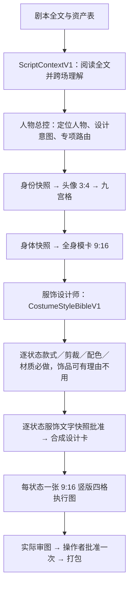
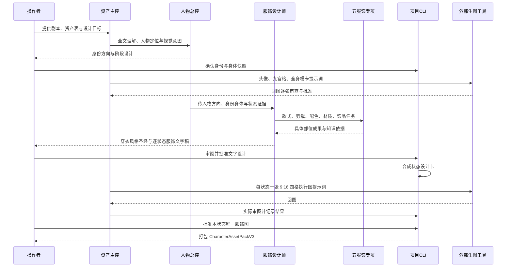
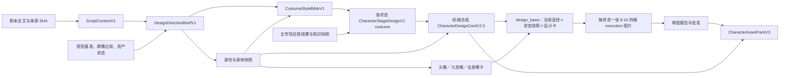

# ZiChan · 资产插件

开宝箱工作室的资产插件仓库，当前交付[角色资产插件](character-assets/README.md)、[场景资产插件](scene-assets/README.md)和[道具资产插件](prop-assets/README.md)。各插件可独立使用，角色设计总控为未来的跨资产美术统筹保留设计简报接口。

## 角色插件 v0.2.6

**0.2.6** 增加必经的 `$character-costume-designer`：从全文人物理解和项目美术基准建立每角色穿衣风格圣经，再统筹款式、剪裁、配色、材质与饰品五专项形成逐状态具体服饰。剧本服装类别是约束，服饰设计要交前背结构、衣层连接、活动余量、材料行为、人物弧线与镜头焦点。两份新教程加强原创面部结构和逐状态妆造；保留 v0.2.5.1 的临时会话隔离。

**阅读全文 → 理解和定位人物 → 解析设计相关细节 → 形成设计意图 → 路由 Skill 或 knowledge/reference → 整合为具体设计。**

人物设计总控 `$character-design` 从全文中的行动、台词、关系、矛盾、变化和剧情作用理解人物，区分人物自述、他人评价与实际行为。全剧分析记录阅读覆盖并按来源版本复用；专项收到与任务有关的人物语境。剧本未写明的外观由总控主动设计，标明事实、推导与创作选择；普通痣、淡雀斑和轻微不对称可随整稿确认，重大身份或剧情新设定单独提出。

总控按任务选择现有 13 个专项：常规项同轮执行对应规范，复杂结构或跨专业冲突独立会诊，并保存真实参与方式和设计成果。默认一套连贯推荐，重要分歧再给备选。用户先集中确认人物方向，再审当前阶段设计；要求“先看一版”时可先交首图候选，实际审图、设计对齐并确认后，同一张图可以转正继续使用。

新项目按 **头像 3:4 → 九宫格表情 → 全身模卡 9:16 → 每状态一张 9:16 竖版四格执行图** 推进。服饰设计先以文字快照批准，再由同一张执行图完成图像审查与批准。身份、身体、穿衣风格圣经和各状态服饰分别记录版本；后续补服装不会自动推翻头像。人物设计齐备后合成完整设计卡并保留来源。头像允许头肩至上胸取景，上胸入画使用对应白色中性背心；全身穿中性背心短裤、赤脚；服饰与执行图使用正式造型。图片按资产名、状态、阶段和短 SHA 命名。

- [下载 character-assets-0.2.6.zip](dist/character-assets-0.2.6.zip)
- [人物理解与设计统筹](character-assets/references/director-understanding.md) · [分阶段设计与候选转正](character-assets/references/phased-design.md) · [接口](character-assets/references/interfaces.md)
- [v0.2.6 真实调用与回归验证记录](research/v0.2.6-validation/README.md)

### 使用入口

完整资产项目提供标准剧本与资产表，场记可选；支持 JSON、Markdown、Excel 和顶层 `AssetProjectSnapshotV1`。只有剧本或人物小传时，也可单独调用人物设计总控，先得到人物理解、设计方向和专项任务，正式建资产时再映射角色 ID。

```text
$character-design 阅读这份完整剧本，理解并定位其中的 CHR-001。
基于人物在全文中的言行、关系和变化给一套设计推荐，主动补足外观留白。
先给人物定位和方向；常规项执行对应专项规范，复杂冲突独立会诊。
```

插件编写提示词，操作者在外部工具生成并回传图片。场景插件当前内置 `$sence-prompts`，交付静态场景设计、光影氛围／色卡、反打与局部修改提示词，不再提供旧 Harness 项目 CLI；道具插件交付逐件设计与完整提示词表，包含材质、配色、纹样符号、轮廓比例四个专项。

### 工作流



新项目为 `pipeline_version:3`，旧 v1/v2 项目按原合同读取。可显式迁移没有已批准服饰或执行图的 v2 项目，保留已批准身份图。

### 交互时序



### 资产数据流



### 历史版本

[v0.2.5 安装包](dist/character-assets-0.2.5.zip) · [v0.2.4.1 安装包](dist/character-assets-0.2.4.1.zip) · [v0.2.3 安装包](dist/character-assets-0.2.3.zip)。旧版设计与批准记录保持可读；升级不自动重做已批准角色。

## 目录

- `character-assets/`：可直接安装的独立插件，包含 Skills、知识快照、Python Harness 和本地项目 CLI。
- `prop-assets/`：道具资产独立插件，包含主技能、四个专项技能和精炼参考，无生图 API 或 Harness 依赖。
- `creator-src/`：角色插件的 Harness Creator 蓝图生成器与自编业务资源；角色插件后续更新先改这里，再审查同步到插件。道具插件直接维护 `prop-assets/`。
- `scene-assets/`：场景资产插件 v0.1.0，当前由 `skills/sence-prompts/` 替换旧实现，提供静态场景设计、光影及反打提示词；使用与替换边界见其 README。
- `scene-creator-src/`：旧场景 Harness 实现的历史源码，不再生成当前插件；当前直接维护 `scene-assets/skills/sence-prompts/`。
- `scene-plugin-maintenance/`：当前场景插件的可复现打包、26 项测试及维护交接 harness；不进入插件安装包。
- `.agents/plugins/marketplace.json`：场景插件本地市场入口，可在仓库根目录添加市场并安装 `scene-assets@scene-assets-local`；详见场景插件 README。
- `dist/`：可下载的安装 ZIP。
- `research/15-视觉故事待接入知识/`：视频提示词未来能力的候选规则，目前不改变已安装插件。

原始课程 DOCX、ZIP、RAR、剧本与人物图片不随仓库发布。`character-assets/knowledge/index.md` 按使用情景定位精炼 reference，`knowledge/source-register.json` 和 `sources.lock.json` 保留来源版本与改写记录。历史服饰条目仅用于寻找线索，具体准确性需要另行查证。

## 本地优先与团队交接

角色插件当前版本为 **v0.2.6**，21 项能力包含人物设计总控、群像差异化与 13 个专项。新项目采用分阶段设计；旧项目保留原有整卡、图像阶段和批准记录。团队可从私有 `kaibaoxiang-studio/ZiChan` 下载完整插件目录或安装 ZIP。设计质量与实际回图按阶段核查，验证材料见[版本验证记录](research/v0.2.6-validation/README.md)。
