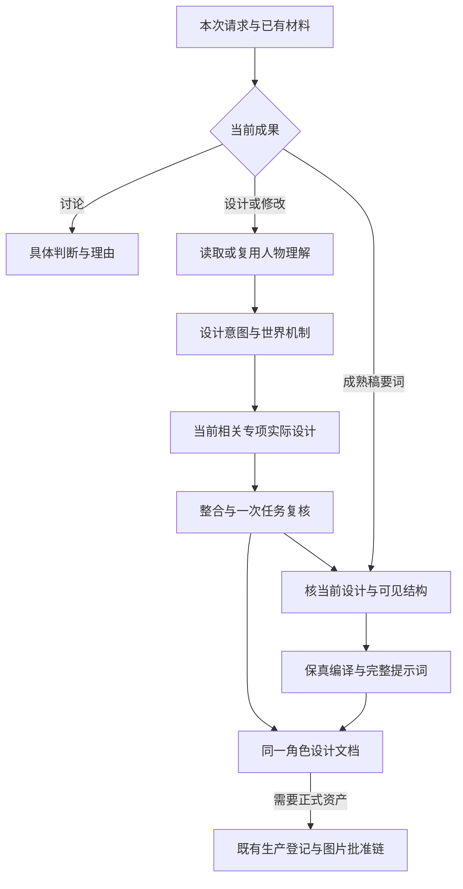
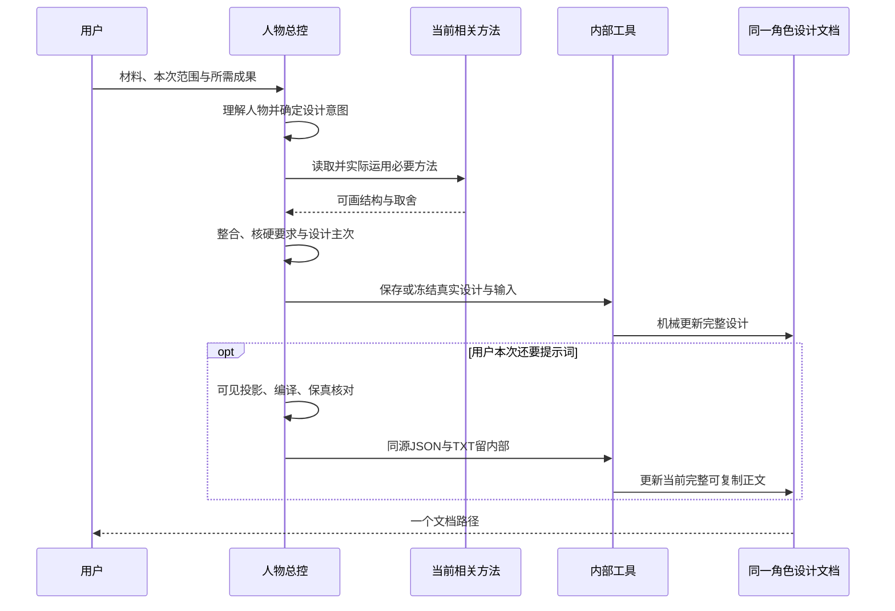
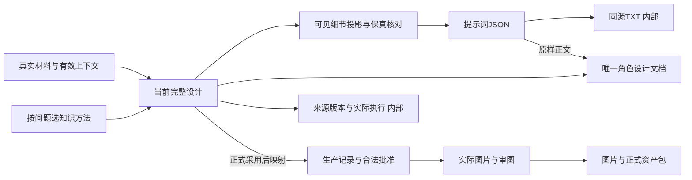

# 角色资产插件 v0.2.16

从剧本、小传或已有角色稿，交一版针对人物的具体设计，再形成可复制提示词；需要正式资产时接入原来的生产阶段。**人只用一份持续更新的角色设计文档，图片单独。** 本版按完整插件发布；安装包、文件哈希和实际验证范围见正式 Release 与 VALIDATION.md，不能把文字能力验证当成图像审美通过。

本版保留22项能力和58份锁定知识快照，重整入口、真实交付、独立候选和用户阅读方式。减的是重复收据、全量加载和无谓等待；人物理解、脸发／身体／衣装的具体结构、世界与人物差异、来源和批准保护继续保留。

## 怎么使用

主入口 `$character-assets`。直接说明本次要什么、给出材料或绝对路径即可，不必先选内部模式：

```text
$character-assets 根据这份人物小传，先设计一版完整人物形象。
脸发、体态和衣装都给具体推荐，普通细节由你决定；不建正式工程，不生图。

$character-assets 沿用当前已批准角色，只试改后脑发量和后颈长度。
脸、分缝和发色不动，先交改稿和候选提示词，暂不采用为正式身份。

$character-assets 按这份成熟角色稿给完整提示词，表达压顺但结构别丢。
更新同一份角色设计文档，后台保留同源文件，不生图。
```

只讨论某个选择时，直接提出问题；本次明确“只要对话文字”才省文件。普通提示词默认后台生成JSON与机械TXT，并将完整正文更新进同一文档；用户无需操作JSON、版本收据或审计表。

正式全员生产可提供标准剧本、资产表及可选场记，沿已有ID和工程推进。成熟外部设计可直接复核接词；缺哪个结构只补哪个，不为补历史收据重做人设。实际给错工程路径会报具体错误，不静默伪装成独立任务。

## 这版怎样做设计

先实际理解全文或复用来源版本一致的有效上下文；小传／片段如实说明范围。区分自述、他评与行为，从矛盾、关系、弧线和观众信息形成设计意图。局部请求只读相关语境与方法，不重开全员规划。

世界通过实际接触、工艺材料、资源、维护和个人选择进入外观，不从职业阶层套脸。专项方法落实到额颧颌颏与五官、前侧后发量、端点明确的比例和体块、主衣衣片／叠压／闭合／固定、色材分区与动作。普通角色也具体；无妆、无饰可以完整设计。重点服装有结构巧思，不能靠多珠宝纹样冒充。

常规由总控inline真实执行，复杂冲突才会诊；主控整合一套推荐，核本次硬要求、人物适配、近邻差异、结构与视觉主次。普通细节整稿审阅，重大剧情身份或已批方向变化才集中提出。结构校验不证明美感，没看图不报实图通过。



## 用户拿到什么

唯一角色设计文档包含当前完整设计、重要取舍、修改结果、当前完整可复制提示词。局部修改合并真实base设计，未改内容仍在文档中；不把文档覆盖成仅剩几句改动。内部JSON／TXT、冻结输入、来源、执行与版本记录保留，但不作为用户需要阅读的一堆交付。

提示词允许同义、合句、去理由和重复，调整强调；当前画幅可见的已选结构全部保留。人物左右、比例、片数、连接、色材和佩戴状态不能静默改。内部源细节映射辅助一次语义复核，不让用户先填表，也不把代码检查说成理解同义。





## 正式生产和旧批准

新pipeline3常规人物仍为头像3:4、表情九宫格、全身9:16中性模卡、每状态一张9:16人形四格执行图；服饰圣经和逐状态文字设计先于执行图。执行图上正脸／45°，下无头放大正面服装／头鞋完整背面。正式服饰不继承模卡背心短裤赤脚。

有台词群演每状态单张执行图，人形四格、非人按获批布局；无台词群像每状态一张完整全身同画布图，明确人数照数，横向比例按辨识选。群演不强套前三身份图／圣经；非人不补造人类器官。

已批角色试改只写task-local草稿，父约束只读；确认采用前不覆盖active或使生产图失效。采用后按原登记批准和实际影响复核相关图片。旧complete、pipeline和schema按原合同读，不自动迁移、补历史收据或整库重画。后台继续ephemeral隔离，不向用户最近聊天注入内部任务。

插件先写提示词，不自行生图；明确授权且会话工具可用时，主控可用同一展示正文生成候选。所有图实际打开审查，用户确认后才正式采用；预览不自动成下游锚点。最终正式资产表仍按单元格内图片规则制作。

## CLI与资料

普通使用不需要手动运行以下命令。内部维护可用真实入口：

```sh
python scripts/character_project.py freeze-design --file /internal/design-result.json --inputs /internal/inputs.json --output /internal/frozen
python scripts/verify_design_delivery.py document --design /internal/design-result.json --prompt /internal/prompt-package.json --output /delivery/角色设计.md
python scripts/character_project.py plan --project-root /work/role-project --character-id CHR-001
```

局部稿更新同一文档时，document使用可重复的 `--base-design` 读取真实旧完整设计或stage记录；不是重新随机补出未改内容。冻结候选不写active ledger，source与真实输入共同校验。正式映射沿现有submit/approve，不新增批准系统。

- [本次路由](references/routing-and-integration.md)、[人物方法](references/director-understanding.md)、[具体设计](references/design-detail-standard.md)
- [专项与冻结交付](references/specialist-contract.md)、[提示词保真](references/prompt-detail-contract.md)
- [正式工作流](references/workflow.md)、[阶段批准](references/phased-design.md)、[生产接口](references/interfaces.md)
- [短知识索引](knowledge/index.md)、[服饰方法](references/costume-designer.md)、[群演单图](references/group-ensemble.md)
- [实际审图](references/review.md)、[局部修图](references/editing.md)、[最终资产表](references/final-asset-table.md)

安装保留整个插件目录，使用Python3.12+；依赖与诊断按RUNTIME及bootstrap配置。Windows项目文件锁与调度恢复探活已改用平台标准接口，并通过模拟Windows API与临时文件回归；尚未在Windows真机验收，不宣称已完成原生Windows端到端验证。知识快照按字节哈希校验。原始剧本、课程ZIP和用户图片不在插件内；知识只打包独立规则与来源收据，许可见[第三方说明](THIRD_PARTY_NOTICES.md)。
