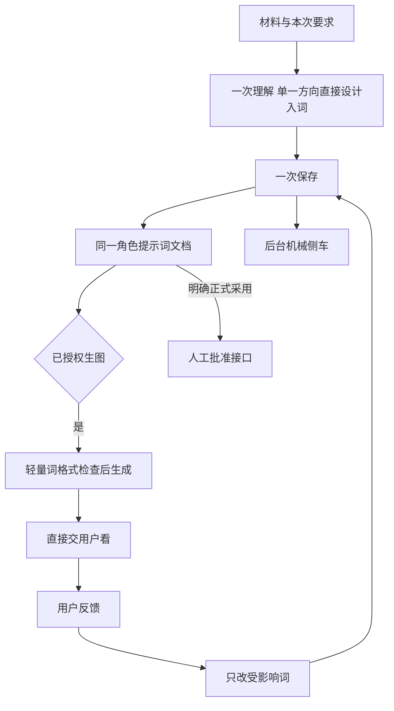
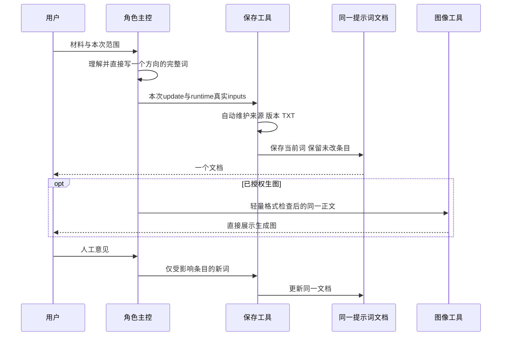
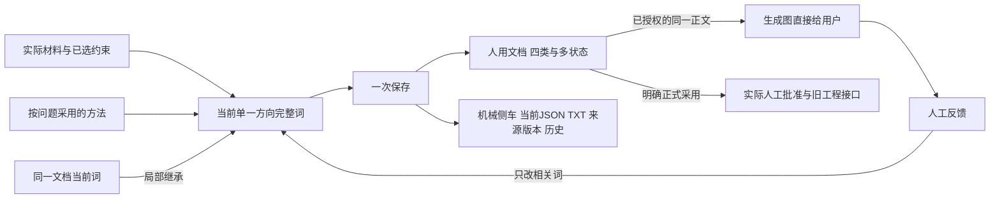

# 角色资产插件 v0.2.20

**总控先设计，再表达为提示词；一个整合方向，一份持续文档。** 每角色一份持续文档，按需维护头像、表情、全身模卡与多状态执行词。用户直接看词提意见，不再先读长设计报告或管理JSON/收据。保留22项能力、58份锁定知识与已有正式项目兼容。

## 怎么用

~~~text
$character-assets 根据这份小传设计苏老太，给同一方向的四类完整提示词。普通细节你决定，不生图。

$character-assets 沿用当前提示词，只改后脑发量和后颈长度，脸、分缝、发色和衣装不动。

$character-assets 在同一文档追加婚礼状态执行词，保持已有身份和体型，不重做其他状态。
~~~

不需要内部模式问卷。完整委托交齐四类；当前只要一阶段/局部则只完成该范围，之后自然追加。成熟稿直接接续，只补真实缺项。普通设计不前置长稿、typed设计、body_form对象、逐专项证明或freeze；具体脸发、五组身体比例、实际剪裁、连接和色材仍直接写在词里，不退成“清秀、干练、真实”。

新建时总控先从人物作用、反差、世界与生活条件形成自己的创作命题和完整造型，专项解决具体设计难题，主要角色逐人成熟，再写成四类可复制提示词。不是把“省文档”变成“省设计”，也不靠每段1000字符凑质量。基础方法在创作时起效，具体难点再深化知识；先设计后表达在同次调用内完成，不新增审计或默认审批。用户仅要词时不外显过程；成熟稿、局部修改和已有图片入表保持直接路线。

默认只给一套整合推荐，不外显A/B/C或大量候选。普通留白主动决定；硬冲突、重大新增剧情设定或改变已批身份才集中问。按问题用相关方法，常规inline，复杂跨域结构/形体工艺或反复失败才会诊，不按专项数量开会。

## 服饰的整体设计与创新

服饰设计师承接人物读法与世界共享边界，主动借用相关reference的轮廓、构成、纹样、工艺和穿法，抽象并人物化后形成整体主张，再由款式/剪裁/配色/材质/饰品共同兑现。各专项约20%局部创新是创造许可，不是改动率或件数；纯审美合法，不需编造剧情身份。设计师整合后仍交一套方向、同一文档，不增加资料审计、强制会诊或自动审图。

差异化相对近邻，别致是有意转折，风格化是一致语法，记忆点需实际观看条件；不把四者当每衣必填配额。共享制服可以克制，不能用复杂度或篇幅证明出彩。方法与边界见[服饰设计师](references/costume-designer.md)。

## 多人种人物设计

新建角色先判断适用的物种、族裔与外貌背景；多族裔世界或用户要求多人种时，总控依据世界与人物关系主动设计新建虚构角色的族裔或混合背景，不按姓名默选单一外貌，也不按固定配额分配。物种/非人形态与人类族裔、文化地域背景分开；采用的背景明确写进每条独立提示词，具体肤色、发质和脸部结构仍需设计。普通留白可作原创选择，确实未知或作者明确不设时可如实未设，不强编国籍血统；换装/局部修改沿用已定身份，不改变已有批准人物。详见[人物方法](references/director-understanding.md)。

## 已有图片整理成资产表

“最终资产表”包含真实嵌入单元格的图片，不是只有路径的JSON或XLSX。直接复用已有资产清单、ID/状态与生成图片，已有图先入表、缺图逐行注明；待定候选可嵌入并标“待用户定稿”，不自动变成批准。仅插表不重启资产提取、美术设计、审图或生成。角色单域保持单域；明确整合委托可汇总三领域已有结果。完成度与人工批准分开说明。详见[嵌图交付规则](references/final-asset-table.md)。

## 文件与修改

唯一人用文件是角色提示词Markdown；四类是同一方向的不同用途，execution按状态分段。工具自动维护后台current.json、同源TXT、真实来源与变更历史，模型不手填hash/父引用/方法台账。更新按阶段与状态合并，未改词原文保留；先读当前文档，不回翻聊天全文重拼设计。用户明确只对话文字时仍交完整正文。

实际保存接口见[普通文档合同](references/prompt-document.md)。Runtime机械提供真实task-inputs.json，模型只写最小update；旧工程可只读继承，错误路径报错，不静默降级。实际验证状态见[VALIDATION](VALIDATION.md)，接口说明不代表尚未运行的验收已通过。

## 图片交付与版式

未授权不生图。获授权时只在生成前做轻量提示词格式检查，使用同一已展示正文，**生成后直接交给用户看**。默认不自动审图、局部修补、复核或重跑；用户人工提意见，明确要求后才审图/编辑。不自称图像通过或替用户正式批准。

人形默认头像3:4、3×3表情、9:16中性全身模卡。执行词先写完整9:16/2×2布局：上约1/3正脸与45°脸，下约2/3左下颈肩以下至鞋、头彻底出画，右下头到鞋完整背面；左下双臂双手和鞋完整，右下不能缩成角落小人。再写当前状态正式衣装/鞋履/妆饰，不能继承模卡背心短裤赤脚。细节见[准确版式](references/execution-sheet.md)。生成文字格式检查不能证明图片实际遵守。

有台词群演与无台词群像每状态单图，不强套前三身份图/服饰圣经；群像按明确人数/槽位，非人按给定形态，不补人类器官。用户明确画幅覆盖按真实请求处理。


## 同一条工作链的三种视图







## 正式生产与旧工程

明确正式生产、旧scope或typed来源仍走原合同，保存真实记录和用户确认；普通候选词无图也可完成，不等待正式上游锚图。旧complete、各pipeline/schema与批准可读，不自动迁移、重建或补历史证明；试改不写active、不使旧图批准提前失效。若明确旧登记操作缺特定材料，说明具体缺项，不自行启动审核/重跑循环来补齐。

人物推荐、程序通过和明确委托的审图结论均不是用户批准。最终正式资产表仍按真实角色/状态与单元格内图片规则交付。


### 人工确认后的正式采用

普通生成后先直接交用户，等待人工意见，不需立即运行批准命令。只有真实用户明确确认了该图，才使用人工批准分支；confirmation-ref必须指向实际用户消息或书面确认，不能自造批准或模型审图结论。

```sh
python scripts/character_project.py approve-image --project-root PROJECT --image-id IMAGE_ID --operator '用户：实际确认人' --human-reviewed --confirmation-ref '真实用户消息或书面确认定位'
python scripts/character_project.py promote-candidate --project-root PROJECT --image-id IMAGE_ID --operator '用户：实际确认人' --human-reviewed --confirmation-ref '真实用户消息或书面确认定位'
```

第二条用于头像preview转正；仅用户同时确认该图及其绑定设计时，才另加--approve-design-basis。两者保留真实来源/版本/依赖核对，只记录人工确认，不创建模型review或虚报verdict/pass。显式模型审图仍是另一个仅按用户请求执行的分支。

- [普通提示词文档](references/prompt-document.md)、[请求路由](references/routing-and-integration.md)、[人物方法](references/director-understanding.md)
- [具体设计](references/design-detail-standard.md)、[知识索引](knowledge/index.md)、[服饰方法](references/costume-designer.md)
- [明确请求才审图](references/review.md)、[明确请求才修图](references/editing.md)、[群演分支](references/group-ensemble.md)
- [正式旧工作流](references/workflow.md)、[阶段批准](references/phased-design.md)、[旧专项合同](references/specialist-contract.md)、[接口](references/interfaces.md)

安装保留完整插件，Python3.12+，依赖与启动见RUNTIME.md。58知识快照与来源许可保留，原始剧本、课程ZIP及用户图片不随包发布。安装包哈希和实际检查以发行manifest/验证记录为准，不预写发布成功。
